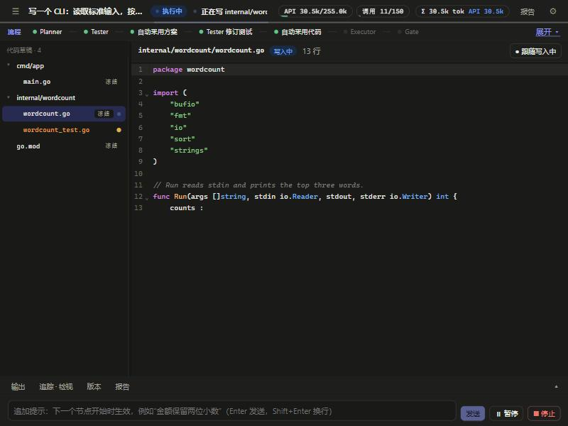

# Verdict（MASA）— 可验证、可恢复、成本可控的编码 Agent Runtime

输入一句需求，系统自动 **规划 → 先写并冻结测试 → 逐文件生成代码 → 在隔离环境里真实运行检查 → 失败就诊断并只修出问题的包 → 给出“通过 / 没通过”和证据**。多个模型分工（便宜的先试，不行再升级，整个任务有预算上限），**“做成没有”由运行时按真实工具结果裁决，不信模型自报**。



## 90 秒看懂

| 你看到的 | 背后是什么 |
|---|---|
| 顶栏一行 **“正在写 internal/stats/stats.go”** | 流式读取模型回答，从**还没写完的 JSON**里增量解出正在写的文件（[`streamfiles.py`](src/masa/runtime/streamfiles.py)） |
| 编辑器里代码**逐字出现**、文件树里跳动的点 | `GET /runs/<id>/live`；写完后可切到“相对上一版”的 diff |
| 底部输入框：**追加提示 / 暂停 / 继续 / 停止** | 人在回路：输入先写账本，**只在节点边界生效**，不打断已付费的调用（[`user_input.py`](src/masa/runtime/user_input.py)） |
| “追踪 · 检视”里点任意一次调用 | 还原**模型这一次看到了什么**：各部分占多少 token、被省略的内容与原因、与上一次共享的前缀、缓存命中（[`call_inspector.py`](src/masa/application/call_inspector.py)） |
| 流程带 / 版本分支 | 事件溯源账本：每次调用先记账再发送，崩溃后已完成的不重做，付费调用结果未知时不盲目重发 |
| 一次失败后只重开出问题的那个包 | V2 修复：失败证据 → 范围内的包工人（写入范围由工具强制）→ 只交出检查结果最好的状态 |


## 真实测到的（样本都很小，只作方向）

- **缓存友好的提示排布**：稳定内容在前、每步都变的在后。零 token 回放 4 841 次真实调用，可缓存前缀 **55.9% → 64.1%**；Go 小任务真实对照（V2、Flash、3 对交替运行），服务端报告的缓存命中率 **39% → 68%**。详见 [PROMPT_LAYOUT](docs/reference/PROMPT_LAYOUT.md)。
- **默认运行方式回归**（只用云端 Flash）：Go 文本统计通过 ¥0.043；Python 大写转换通过 ¥0.016；V2 在 Go 词频任务通过 ¥0.045。
- **测试**：后端 717 项、前端 60 项；默认流程与上一提交的差分检查逐项相同（零 token）。
- 其余评测（10 级 23 题、独立判官、假通过率）见 [PROJECT_OVERVIEW](docs/PROJECT_OVERVIEW.md) 与 [评测指南](docs/guides/USER_BENCHMARK.md)。**没有测到的不写数字。**

## 快速开始（Windows）

```powershell
# 终端 1：后端 API（只监听本机）
.\.venv\Scripts\python.exe -m masa serve --port 8765
# 终端 2：前端
cd frontend; npm install; npm run dev      # http://127.0.0.1:5173
```

先在 **设置 → 模型配置** 添加一个云端模型（或在 **本地运行时** 选 Ollama 模型），再在首页描述需求。需要 Go 或 Python 工具链：见 [Go 环境](docs/guides/USER_GO_ENVIRONMENT_AND_TESTING.md)、[新增一种语言](docs/guides/ADD_A_LANGUAGE.md)。Docker 部署见 [DEPLOY_DOCKER](docs/guides/DEPLOY_DOCKER.md)。

```bash
PYTHONPATH=src python -m pytest -q          # 后端（4 个既有 ERROR 是被误收集的 test_* 函数）
cd frontend && npx vitest run && npm run build
```

## 文档

[项目总览（先读）](docs/PROJECT_OVERVIEW.md) · [路线图与终点](docs/ROADMAP.md) · [使用工作台](docs/guides/USER_WORKBENCH.md) · [文档索引](docs/00_INDEX.md) · [简历描述](docs/RESUME_PROJECT_DESCRIPTION.md)

## 做不到 / 没做的

追加**需求**（需求版本化）只有设计；Gate 通过只代表所选检查通过，不等于业务一定正确；混合（本地起步）目前不一定比纯云端好；样本小，不是通过率。完整列表见 [PROJECT_OVERVIEW §7](docs/PROJECT_OVERVIEW.md)。
