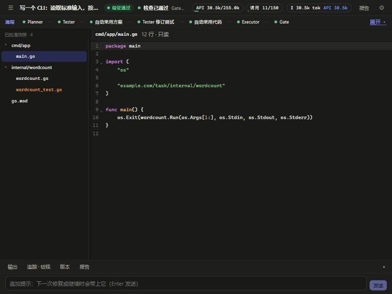
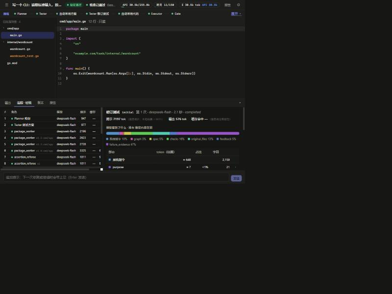

# 使用工作台

前后端分离：先启动后端 API，再启动前端（先关闭旧服务）。

```powershell
# 终端 1：后端 API（默认 8765，只监听本机）
.\.venv\Scripts\python.exe -m masa serve --port 8765

# 终端 2：前端（首次需要 npm install）
cd frontend
npm install
npm run dev        # http://127.0.0.1:5173
```

或一键：`.\scripts\dev.ps1`。后端地址不同时，在 `frontend/.env` 设置 `VITE_API_BASE`；前端换了端口，用 `masa serve --origin http://127.0.0.1:端口` 加入白名单。生产式预览：`npm run build && npm run preview`（4173，已在默认白名单）。

## 新任务页

写需求时页面会实时给出**开跑前估计**（本地模型推测难度、系统能不能处理、云端 API token 三档与价格区间，选中的档位就是 token 上限）；需求点名了第三方包时会先问你；首页的推荐任务含模糊需求，可以“换一批”。Python 项目跑在项目自己的环境 `.tools/pyenv` 里。详见 [PROJECT_PYTHON_ENV](PROJECT_PYTHON_ENV.md)。

## 界面（任务页 = 工作台）



1. **顶栏（一行）**：任务名、状态、**现在在做什么**（“正在写 internal/stats/stats.go”“Developer 正在思考…”“请确认生成的代码”）、用量与缓存命中、报告、设置。☰ 展开/收起左侧任务列表（任务页默认收起）。
2. **流程带（一行）**：每个阶段一枚小标签，当前阶段高亮；点“展开”看完整流程图与版本分支；点一个阶段会在底部“追踪”里选中这个角色的调用。
3. **文件树 + 编辑器**：模型写文件时，编辑器**自动跟随**，代码逐字出现（文件树里正在写的文件有跳动的点）；点别的文件就停止跟随，右上角“跟随写入”可再打开。写完后若有上一版，可切到“相对上一版”的 diff；审核阶段可直接编辑，“批准并验证”提交的正是你看到的内容。
4. **需要你时才出现的卡片**：澄清问题、确认方案、审阅代码，出现在编辑器上方；不需要你时这里什么都没有。
5. **底部面板（默认折叠，点开才加载）**：**输出**（真实工具结果，终端样子，失败线索可点击跳到源码行）· **方案**（规格与验收，可编辑）· **追踪 · 检视**（每次模型调用一行；点开看模型看到了什么：各部分占多少 token、被省略的内容、与上一次共享的前缀、缓存命中、你的提示）· **版本**（版本分支、来源链日志、“跟随执行”开关）· **报告**。
6. **输入框（最底部）**：追加提示（Enter 发送，**在下一个节点开始时生效**，不会打断正在进行的调用）；运行中可 **暂停 / 继续 / 停止**（暂停也是在节点边界停住）。
7. **设置**：常用的分区常驻（模型配置、模型与次序、API 账户、本地运行时、路由与预算、语言、评测），偏内部的收进“高级”（动态角色、实验结果、Harness、诊断）。



「跟随执行」开启时页面跟着执行中的版本走；你主动点历史或节点后它自动关闭，后台事件只弹提示，不抢页面。后端目前串行：有任务运行时只是不能开始新的模型任务，浏览和编辑不受影响。

追加“需求”（改需求版本）还没做——目前只能追加**提示**；设计见 [ROADMAP](../ROADMAP.md) 的人在回路第 3 级。复验已有随机数版本：`.venv/Scripts/python.exe scripts/eval/evaluate_seeded_random.py --run 77604ca3e7184958938a421da76c4978` 不调用模型；生成脚本会调用指定模型，请显式选择。
